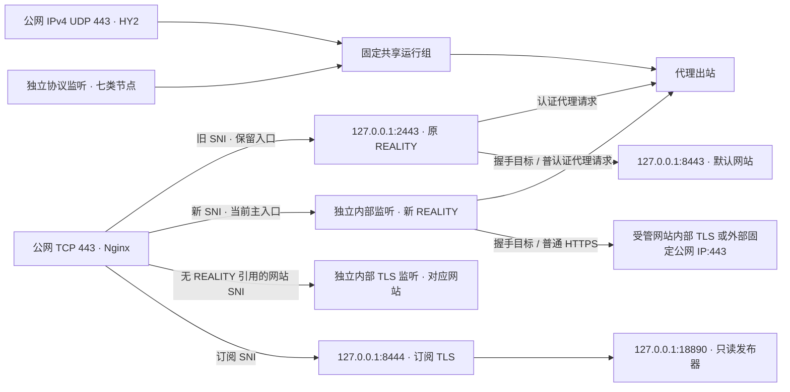

# ProxyHub

独立、模块化的 VPS 与代理服务管理项目。提供命令行和管理面板，再逐步加入规则管理与更多协议。

当前版本为 `0.7.1a1`：实施阶段 2 的最小资源调整，保留两个独立 REALITY 进程，将 HY2 与七类额外节点合为一个固定共享运行组，保留节点身份、端口、凭据、证书、网站、订阅入口及原命令。专用 VPS 已部署并完成执行会话自测，等待独立审计；本轮结果与未关闭事项见[共享组执行交付](docs/phase2-protocols-acceptance.md#2026-10-16-固定共享运行组执行交付)，不表示审计已放行。`0.7.0a1` 的协议功能验收及限制继续保留，见[能力矩阵](docs/superpowers/specs/2026-10-14-proxyhub-design.md#6-proxy-与-rules)。本轮交付后停下等待审计，不自行进入阶段 3a。

## 当前能力

- **SSH**：针对账号和实际连接条件读取 OpenSSH 生效配置；保留原授权项，检查重复公钥和限制选项冲突，准备计划后备份并原子追加。登录是否成功由第二个独立 SSH 会话验证。
- **网站**：创建、选择、启停和删除独立静态网站，绑定/解绑域名，逐站上传 ZIP、隔离预览及恢复内容版本/默认模板。Nginx SNI 分流共用 TCP 443；未被 REALITY 入口引用的域名直达对应内部 HTTPS 监听，默认网站和首域名按旧配置兼容保留。
- **REALITY**：选择本机受管网站或外部 HTTPS 443 目标，地址与 SNI 分开校验；检查 DNS、固定公网 IP、TLS 1.3/X25519、证书与回环边界。迁移启动独立新入口并保留旧入口进程，支持切回保留入口及显式退役；不能退役主入口或最后一个入口。
- **HY2**：创建、更新、启用或停用一个稳定本机节点，默认独立 IPv4 UDP 443。显式绑定证书与 SNI，自动生成并保留随机密码；停用保留凭据和证书依赖，从订阅移除条目。共享布局下与额外节点共用进程，运行配置变化会使 HY2 与全部启用额外节点的现有连接重连，REALITY 与网站进程保留。
- **独立节点**：最多 32 个稳定资源，支持 VLESS、VMess、Trojan、六种 SS 方法、TUIC v5、AnyTLS 与认证 SOCKS5。身份、IPv4 监听、凭据和证书/REALITY 目标依赖各自独立，运行进程与 HY2 共享；创建、更新、启停和先停后删均经计划。SOCKS5 的服务端 UDP 拒绝规则限定对应入站。
- **证书**：通过 HTTP-01 申请或导入，按稳定绑定 ID 替换与续期。列出网站、订阅、HY2、独立节点及 REALITY 目标的直接/间接消费者，停用仍保留依赖。共享组内启用成员的材料变化时切换整个组，分别验证所有启用成员及所选证书的可信链/名称和叶指纹，失败恢复旧材料与布局。
- **订阅**：唯一 TypeScript 生成器依次输出原 REALITY、启用 HY2 和独立节点的 YAML、URI/Base64，手选组保持 REALITY 优先，用户覆盖保留。H2 的 Mihomo YAML 仅承诺 TCP；存在 `udp:false` 节点时默认 rule 末尾拒绝，避免意外 DIRECT。原始 URI 导入器能力边界另行说明，不能代替 YAML 验收。
- **变更**：复用不可变候选、渲染、事务、生成器与恢复入口。组级预览列出受影响成员；共享运行配置变化时检查全部启用成员，未变化的名称或订阅元数据不重启共享组。独立发布进程提供最后一份有效订阅。
- **命令**：仅新增 `proxyhub` 和 `proxyhub-*` 服务；不覆盖 `sb`、`sing-box`、`yuju`、`subboost` 或 shell 内置 `help`，端口及资源冲突会停止操作。
- **面板**：经 SSH 隧道访问，低权限网关与 root 管理器分离；支持多站点、证书依赖、内容生命周期、REALITY 迁移、HY2 与其余节点生命周期、订阅元数据/覆盖、公钥追加。与 CLI 共用类型化操作；旧版本计划不可覆盖新配置，见[面板手册](docs/panel.md)。

当前安装脚本只面向 **Debian 12 amd64、systemd、root** 的专用验收环境。帮助与纯配置测试可在 Windows/Linux 运行。Ubuntu、其他发行版和 arm64 的完整安装验收尚未完成。

## 验证状态

| 范围 | 状态与证据 |
| --- | --- |
| 六个来源项目、许可证、固定提交 | 已核对，[来源与取舍](docs/phase0-sources.md) |
| sing-box 1.14.3 / Mihomo 1.19.32 官方资产 | 六份 Linux/Windows 资产的哈希与大小通过；Windows 可执行能力检查通过，[运行时核验](docs/phase0-runtime.md) |
| Nginx 1.30.5 / Node 24.21.0 | 官方签名和哈希链通过，[启动运行时核验](docs/bootstrap-verification.md) |
| SSH 第二会话、网站与真实 REALITY 请求、下载订阅使用 | 专用 VPS 实测通过，[阶段 1 验收](docs/phase1-acceptance.md) |
| 管理面板与四类操作、订阅独立发布、管理服务停止后的公网闭环 | 专用 VPS 与真实浏览器实测通过，[面板阶段验收](docs/phase2-panel-acceptance.md) |
| 阶段 2a 单站点上传、隔离预览与内容恢复 | 234 项 Linux 相关测试、真实浏览器与公网代理请求通过，见[阶段 2a 验收记录](docs/phase2a-content-acceptance.md) |
| 阶段 2b 多站点与证书依赖 | 双站公网 HTTPS、原 REALITY/订阅、依赖保护、冲突预检及新消费者失败恢复通过；346 项 Linux 相关测试、125 项 subtests 通过，见[阶段 2b 验收记录](docs/phase2b-multisite-acceptance.md) |
| 阶段 2c REALITY 目标与 SNI 迁移 | 本机/外部目标真实代理、新旧 SNI 共存、旧长连接保留、显式退役、失败回滚及真实进程中断恢复通过；377 项 Linux 相关测试、125 项 subtests 通过，见[阶段 2c 验收记录](docs/phase2c-reality-acceptance.md) |
| 阶段 2d HY2 与协议能力矩阵 | 增量通过：真实面板生命周期、双协议 IPv4 TCP/UDP 请求、证书切换与信任失败回滚、依赖保护及进程中断恢复；Linux 相关 483 项、125 项 subtests 通过，见[阶段 2d 验收记录](docs/phase2d-hy2-acceptance.md) |
| 阶段 2 其余选定协议 | 45 组 TCP/HTTPS、40 组 UDP 转发与 5 组关闭边界、个人电脑 10 个入口、六项故障演练通过；Linux 589 个不同测试及 125 项 subtests 通过，见[协议收口验收](docs/phase2-protocols-acceptance.md) |
| `0.7.1a1` 固定共享运行组 | 已部署并完成执行自测；最终 7 项服务、8 个进程、3 个核心，284 个应用文件一致，两条 REALITY 长连接各 822 轮无错误，配置、网站与订阅保持；[证据及剩余事项](docs/phase2-protocols-acceptance.md#2026-10-16-固定共享运行组执行交付)，待独立审计 |

当前受管代理仅启用 IPv4，公网 IPv6 未验证。Trojan H2 明确拒绝，VLESS/VMess H2 的 UDP 未通过锁定 Mihomo 验收，不计为支持。2026-10-16 审批确认 `0b1d5b1` 部署的 284 个文件一致、14 项服务 active；当时 15 个相关进程 RSS 约 772.2 MiB，高于方案的 350 MiB 目标。PSS 约 308.7 MiB 不替代 RSS 门槛，详见[审批复核](docs/phase2-protocols-acceptance.md#2026-10-16-进度审批复核)。本轮迁移后常驻 RSS 的 10 次短时样本最大 316.45 MiB，符合现有负载工作预算 ≤325 MiB；按 0.2 秒采样的迁移后证书/故障/中断/连接影响窗口观测峰值 579.79 MiB，计入相关瞬态进程、排除采样器自身，OOM 增量 0。首次迁移前为 772.26 MiB，迁移全过程峰值未验证，不能声称全过程低于 650 MiB；首轮故障自动恢复未完成而保留 pending，显式 recover 成功、随后复测通过，初次根因仍未验证，不能写成已修复。完整边界见[执行记录及 JSON 证据](docs/phase2-protocols-acceptance.md#2026-10-16-固定共享运行组执行交付)。原 RSS <350 MiB、峰值 <650 MiB、无 OOM 指标不变；正式 1 核 1GB、5 订阅/500 节点 PERF-1、本轮个人电脑外网复验和真实浏览器/指定 GUI 均未验证。

## 开始使用

需要 Python 3.11+；构建订阅生成器需要 Node 24 和 npm。先创建并进入 Python 虚拟环境，再执行：

```sh
python -m pip install -e .
proxyhub help
proxyhub help host append-key
proxyhub deployment plan --help

npm ci
npm run build
python -m pip install pytest
python -m pip install -r requirements-panel.lock httpx==0.28.1
python -m pytest -q
```

`proxyhub help`、嵌套 `help` 和 `--help` 不要求 root、不创建状态、不访问网络。安装与操作 Linux 服务器的完整步骤见[阶段 0–1 操作手册](docs/runbook.md)；现阶段没有通用的一键生产安装器。

## 网站内容

上传包须为不超过 **180 KiB** 的 ZIP，实际解压总量不超过 **2 MiB**、文件和目录合计不超过 **200 项**，根目录包含非空 UTF-8 `index.html`。只接受白名单中的 HTML、CSS、JS、JSON、文本、图片和字体扩展，完整列表见[面板手册](docs/panel.md#网站内容上传预览与恢复)。隔离预览 HTML 上限为 **512 KiB**，禁用脚本与外部资源，CSS `url()` 和依赖 JavaScript 的效果可能无法完整呈现。公网网站仅允许同源外置 `.js` 脚本，内联脚本和外部资源不放行。

以下命令需 Linux root。不传 `--site-id` 时沿用默认网站；为 `upload`、`versions` 或 `restore` 加上 `--site-id <SITE_ID>` 可选择其他网站。上传和恢复均先输出计划，检查预览后再显式 `apply`；恢复默认模板时将版本 ID 替换为 `template`：

```sh
proxyhub site content upload --archive /root/website.zip
proxyhub site content preview --plan-id <PLAN_ID> --output /root/website-preview.html
proxyhub apply <PLAN_ID>
proxyhub site content versions
proxyhub site content restore --version <CONTENT_VERSION_ID>
# 对恢复命令返回的新计划，再执行 preview / apply。
```

仅所属网站已成功应用的内容版本可恢复；阶段 2a 历史继续归属默认网站。上传和恢复沿用当前域名、证书、REALITY 节点与订阅，只重载 Nginx 和订阅发布器，保留代理进程；后续订阅或证书变更保留各站点上传内容。网站标题仅在默认模板下可编辑。CLI 预览文件以 `0600` 权限写入，不应加入仓库，查看后按需删除。多站点创建与证书操作、从 2a 升级后的首次 Web 激活顺序见[面板手册](docs/panel.md#多站点与证书依赖)。

## 端口与路径



TCP 80 用于 HTTP-01 和 HTTPS 跳转。升级须运行 `proxyhub install-services` 安装自有单元；该命令不切换运行布局或重启公网服务。旧布局先执行 `proxyhub deployment migrate-runtime`，核对组级影响后再显式 `proxyhub apply` 返回的计划；旧 HY2 与 `proxyhub-node@.service` 单元及配置保留用于失败/中断恢复，普通节点操作不会隐式迁移。安装目录为 `/opt/proxyhub`，私有状态位于 `/var/lib/proxyhub`；新命令为 `/usr/local/bin/proxyhub`。运行时内部命令只在 `/opt/proxyhub/bin` 使用，不替换全局同名程序。步骤见[共享组迁移说明](docs/panel.md#固定共享运行组与旧布局迁移)。

从 `0.6.0a1` 升级时，须在旧有效 bundle 仍为当前版本、首次应用额外协议前重启一次 publisher，加载新 URI 校验器；manager/panel 同步更新代码，原 REALITY/HY2 与 Nginx 保留。后续节点操作仅 reload publisher；共享组运行配置变化时仍须重启该组。证书归档仍为 root 专有目录 `0700`、私钥 `0600`，所需 PEM 嵌入 `0640 root:proxyhub-proxy` 的 `shared.json`，原 `hy2.json` 与 `nodes/<id>.json` 保留校验及恢复用途，不放宽归档权限。

## 后续阶段

阶段 2 已按能力矩阵明确支持的本机范围通过历史功能验收。[资源前置评估](docs/phase2-protocols-acceptance.md#2026-10-16-资源前置评估)的约 311 MiB 为当时隔离估算；`0.7.1a1` 已部署并完成本轮资源调整的执行自测，停在交付点等待独立审计。迁移后实测、故障恢复和阶段是否通过由审计会话独立核验；不得把自测结果写成审计放行或自行进入 3a。后续阶段范围与离开条件保留于[总方案 10.2](docs/superpowers/specs/2026-10-14-proxyhub-design.md#102-阶段-2-结果与阶段-3-执行顺序)，完整 Host 初始化、SSH 防失联、CLI 帮助契约与发行验收仍按总方案承接。

多订阅、MRS 规则流水线、共享流量账户、自动采集与周期重置尚未交付。当前默认 sing-box 包不含 V2Ray API，因此没有把手工额度显示标为自动计量；当前 `reset_day/reset_at` 也不会触发自动重置。

ProxyHub 原创代码采用 [AGPL-3.0-only](LICENSE)。参考来源、独立运行时和依赖的归属见 [NOTICE](NOTICE.md)。公开仓库不保存真实服务器身份、SSH 私钥、节点凭据或完整订阅链接。
