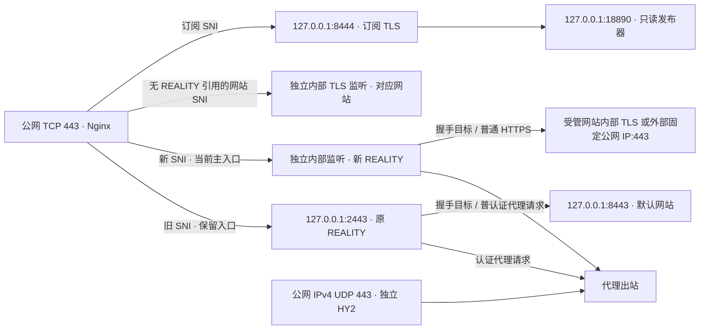

# ProxyHub

独立、模块化的 VPS 与代理服务管理项目。提供命令行和管理面板，再逐步加入规则管理与更多协议。

当前版本为 `0.6.0a1`：在已验收的阶段 2a 内容生命周期、2b 多站点与证书依赖、2c REALITY 新旧 SNI 迁移基础上，阶段 **2d 本机 HY2 生命周期与协议能力矩阵**增量已通过专用 VPS 验收。HY2 使用独立 IPv4 UDP 监听及可信证书，与现有 TCP 服务共存；REALITY/HY2 的公网 TCP 请求及应用 UDP 回显、证书切换、失败恢复均通过。完整阶段 2 与首版发行仍未完成；审批历史、完整范围及后续顺序见[总方案第 10 节](docs/superpowers/specs/2026-10-14-proxyhub-design.md#10-实施阶段和交付门槛)。

## 当前能力

- **SSH**：针对账号和实际连接条件读取 OpenSSH 生效配置；保留原授权项，检查重复公钥和限制选项冲突，准备计划后备份并原子追加。登录是否成功由第二个独立 SSH 会话验证。
- **网站**：创建、选择、启停和删除独立静态网站，绑定/解绑域名，逐站上传 ZIP、隔离预览及恢复内容版本/默认模板。Nginx SNI 分流共用 TCP 443；未被 REALITY 入口引用的域名直达对应内部 HTTPS 监听，默认网站和首域名按旧配置兼容保留。
- **REALITY**：选择本机受管网站或外部 HTTPS 443 目标，地址与 SNI 分开校验；检查 DNS、固定公网 IP、TLS 1.3/X25519、证书与回环边界。迁移启动独立新入口并保留旧入口进程，支持切回保留入口及显式退役；不能退役主入口或最后一个入口。
- **HY2**：创建、更新、启用或停用一个稳定本机节点，默认独立 IPv4 UDP 443。显式绑定证书与 SNI，自动生成并保留随机密码；停用保留凭据和证书依赖，从订阅移除条目。启停或更新只调整 HY2 和订阅发布器，原 REALITY 入口与网站进程保留。
- **证书**：通过 HTTP-01 申请或导入，按稳定绑定 ID 替换与续期，证书材料按版本保存。列出网站、订阅、HY2 及所有存续 REALITY 入口的间接消费者，保护仍被引用的资源。HY2 证书材料路径变化时重启其独立实例，分别验证可信链/名称与实际加载指纹，失败恢复旧部署。
- **订阅**：由唯一 TypeScript 生成器输出 REALITY 当前主入口及已启用 HY2 的 YAML 和 URI/Base64；手选组默认 REALITY 优先。正文、响应头和访问路径作为同一发布版本。手工流量信息与重置字段分别保存，元数据更新不依赖握手目标在线。
- **变更**：准备不可变候选、执行核心配置检查、显式 `apply`；保留激活日志和失败恢复入口。网站与证书使用 Web 激活，重载 Nginx 与订阅发布器，保留 REALITY 进程；仅在 HY2 实际配置或证书路径变化时调整 HY2。独立发布进程提供最后一份有效订阅。
- **命令**：仅新增 `proxyhub` 和 `proxyhub-*` 服务；不覆盖 `sb`、`sing-box`、`yuju`、`subboost` 或 shell 内置 `help`，端口及资源冲突会停止操作。
- **面板**：经 SSH 隧道访问，低权限网关与 root 管理器分离；支持多站点及证书管理、逐站内容上传/预览/恢复、REALITY 迁移/切回/退役、HY2 生命周期、订阅元数据与配置覆盖、公钥追加。变更需先预览，旧版本计划不可覆盖新配置，见[面板手册](docs/panel.md)。

当前安装脚本只面向 **Debian 12 amd64、systemd、root** 的专用验收环境。帮助与纯配置测试可在 Windows/Linux 运行。Ubuntu、其他发行版和 arm64 的完整安装验收尚未完成。

## 验证状态

| 范围 | 状态与证据 |
| --- | --- |
| 六个来源项目、许可证、固定提交 | 已核对，[来源与取舍](docs/phase0-sources.md) |
| sing-box 1.14.3 / Mihomo 1.19.32 官方资产 | 六份 Linux/Windows 资产的哈希与大小通过；Windows 可执行能力检查通过，[运行时核验](docs/phase0-runtime.md) |
| Nginx 1.30.5 / Node 24.21.0 | 官方签名和哈希链通过，[启动运行时核验](docs/bootstrap-verification.md) |
| SSH 第二会话、网站与真实 REALITY 请求、下载订阅使用 | 专用 VPS 实测通过，[阶段 1 验收](docs/phase1-acceptance.md) |
| 管理面板与四类操作、订阅独立发布、管理服务停止后的公网闭环 | 专用 VPS 与真实浏览器实测通过，[面板阶段验收](docs/phase2-panel-acceptance.md) |
| 阶段 2a 单站点上传、隔离预览与内容恢复 | 234 项 Linux 相关测试、真实浏览器与公网代理请求通过，见[阶段 2a 验收记录](docs/phase2a-content-acceptance.md) |
| 阶段 2b 多站点与证书依赖 | 双站公网 HTTPS、原 REALITY/订阅、依赖保护、冲突预检及新消费者失败恢复通过；346 项 Linux 相关测试、125 项 subtests 通过，见[阶段 2b 验收记录](docs/phase2b-multisite-acceptance.md) |
| 阶段 2c REALITY 目标与 SNI 迁移 | 本机/外部目标真实代理、新旧 SNI 共存、旧长连接保留、显式退役、失败回滚及真实进程中断恢复通过；377 项 Linux 相关测试、125 项 subtests 通过，见[阶段 2c 验收记录](docs/phase2c-reality-acceptance.md) |
| 阶段 2d HY2 与协议能力矩阵 | 增量通过：真实面板生命周期、双协议 IPv4 TCP/UDP 请求、证书切换与信任失败回滚、依赖保护及进程中断恢复；Linux 相关 483 项、125 项 subtests 通过，见[阶段 2d 验收记录](docs/phase2d-hy2-acceptance.md) |

配置检查不代表真实客户端请求通过。本次 HY2 仅启用 IPv4，公网 IPv6 未验证。Clash Verge Rev 2.5.8 的 GUI 导入与显示、1 核 1GB 资源指标仍待专门验收。

## 开始使用

需要 Python 3.11+；构建订阅生成器需要 Node 24 和 npm。先创建并进入 Python 虚拟环境，再执行：

```sh
python -m pip install -e .
proxyhub help
proxyhub help host append-key
proxyhub deployment plan --help

npm ci
npm run build
python -m pip install pytest
python -m pip install -r requirements-panel.lock httpx==0.28.1
python -m pytest -q
```

`proxyhub help`、嵌套 `help` 和 `--help` 不要求 root、不创建状态、不访问网络。安装与操作 Linux 服务器的完整步骤见[阶段 0–1 操作手册](docs/runbook.md)；现阶段没有通用的一键生产安装器。

## 网站内容

上传包须为不超过 **180 KiB** 的 ZIP，实际解压总量不超过 **2 MiB**、文件和目录合计不超过 **200 项**，根目录包含非空 UTF-8 `index.html`。只接受白名单中的 HTML、CSS、JS、JSON、文本、图片和字体扩展，完整列表见[面板手册](docs/panel.md#网站内容上传预览与恢复)。隔离预览 HTML 上限为 **512 KiB**，禁用脚本与外部资源，CSS `url()` 和依赖 JavaScript 的效果可能无法完整呈现。公网网站仅允许同源外置 `.js` 脚本，内联脚本和外部资源不放行。

以下命令需 Linux root。不传 `--site-id` 时沿用默认网站；为 `upload`、`versions` 或 `restore` 加上 `--site-id <SITE_ID>` 可选择其他网站。上传和恢复均先输出计划，检查预览后再显式 `apply`；恢复默认模板时将版本 ID 替换为 `template`：

```sh
proxyhub site content upload --archive /root/website.zip
proxyhub site content preview --plan-id <PLAN_ID> --output /root/website-preview.html
proxyhub apply <PLAN_ID>
proxyhub site content versions
proxyhub site content restore --version <CONTENT_VERSION_ID>
# 对恢复命令返回的新计划，再执行 preview / apply。
```

仅所属网站已成功应用的内容版本可恢复；阶段 2a 历史继续归属默认网站。上传和恢复沿用当前域名、证书、REALITY 节点与订阅，只重载 Nginx 和订阅发布器，保留代理进程；后续订阅或证书变更保留各站点上传内容。网站标题仅在默认模板下可编辑。CLI 预览文件以 `0600` 权限写入，不应加入仓库，查看后按需删除。多站点创建与证书操作、从 2a 升级后的首次 Web 激活顺序见[面板手册](docs/panel.md#多站点与证书依赖)。

## 端口与路径



TCP 80 用于 HTTP-01 和 HTTPS 跳转。示意图展示迁移共存期；HY2 仅在创建并应用后启动，不启用 IPv6 监听或网站 HTTP/3。目标探测通过不能代替真实客户端验证，也不保证外部目标持续健康。升级须运行 `proxyhub install-services` 安装 REALITY 模板与独立 HY2 单元，该命令不启动新入口或重启现有公网服务。安装目录为 `/opt/proxyhub`，私有状态位于 `/var/lib/proxyhub`；新命令为 `/usr/local/bin/proxyhub`。运行时内部命令只在 `/opt/proxyhub/bin` 使用，不替换全局同名程序。操作参数见[面板手册](docs/panel.md)。

从 `0.5.0a1` 升级时，须在旧有效 bundle 仍为当前版本、首次应用 HY2 前重启一次 publisher，以加载支持 HY2 的新校验器；manager/panel 也为代码升级重启，REALITY 新旧实例与 Nginx 保留。后续 HY2 操作只 reload publisher。证书归档仍为 root 专有目录 `0700`、私钥 `0600`，所需 PEM 嵌入 `0640 root:proxy` 的 `hy2.json`，不放宽归档权限；升级步骤及秘密材料边界见[面板手册](docs/panel.md#安装与访问)。

## 后续阶段

阶段 2b、2c、2d 增量已通过，下一步继续收口阶段 2 其余选定协议门槛，完成后再进入订阅与规则阶段。各协议已实现、待实现和不支持边界见[总方案协议矩阵](docs/superpowers/specs/2026-10-14-proxyhub-design.md#6-proxy-与-rules)。完整 Host 初始化、SSH 防失联、CLI 帮助契约及发行验收也已在总方案明确归属，不能以现有公钥追加和面板代替。

多订阅、MRS 规则流水线、共享流量账户、自动采集与周期重置尚未交付。当前默认 sing-box 包不含 V2Ray API，因此没有把手工额度显示标为自动计量；当前 `reset_day/reset_at` 也不会触发自动重置。

ProxyHub 原创代码采用 [AGPL-3.0-only](LICENSE)。参考来源、独立运行时和依赖的归属见 [NOTICE](NOTICE.md)。公开仓库不保存真实服务器身份、SSH 私钥、节点凭据或完整订阅链接。
