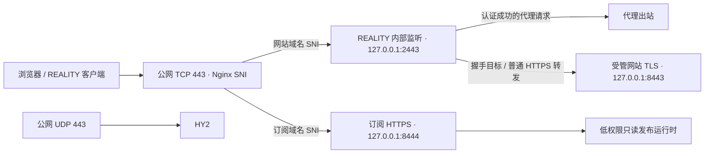

# ProxyHub 模块化管理设计

设计基线：2026-10-14。进度审批与方案重对齐：2026-10-15（Asia/Shanghai）。本文保留已批准的完整产品目标；除第 10 节明确验收的范围外，其余能力和指标仍是实施目标，不能作为当前版本的功能说明。

独立仓库 `Forlooong/proxyhub` 已建立；前次审批时的 `0.3.0a1`（`be88cac9a33ac4f1763411d2c9ee438ffee480ca`）已部署到专用 Debian 12 amd64 测试 VPS。当前 `0.4.0a1` 的阶段 2b 多站点与证书依赖增量也已通过该专用 VPS 验收，承接阶段 0–1、已有能力的管理面板和阶段 2a 单站点内容交付；完整阶段 2 及首版发行尚未完成。本文件是后续实施的唯一总方案，当前状态与下一增量见第 10 节。来源核验与设计时的知识快照见 [知识与证据](../../knowledge/proxyhub-evidence.md)，当前可用功能见 [README](../../../README.md)。

## 1. 产品范围与取舍

每台 VPS 独立运行，由一名管理员通过 CLI 或 SSH 隧道内的面板管理。面向 Debian 12/13、Ubuntu22.04/Ubuntu 24.04、systemd、amd64/arm64，资源基线为 1 核 1GB。首版提供完整管理面板，支持全新安装，不接管旧部署或自动迁移旧状态。

核心流程是初始化服务器，建立受管网站与证书，创建代理节点，组合可更新规则与客户端配置，发布客户端可导入订阅。先完成单节点真实客户端请求，再增加分流、备用协议和链式代理。

输出支持 Mihomo YAML、原始分享 URI/Base64 订阅及二维码。首版不输出 sing-box 客户端 JSON/SRS、Surge 等格式，不提供多人商业面板、DNS 托管、动态网站运行环境。Docker 与诊断为可选扩展，不成为安装依赖。

| 来源 | 选择继承 | 拆解或放弃 |
| --- | --- | --- |
| [233boy/sing-box](https://github.com/233boy/sing-box) | 操作覆盖、协议参数与使用流程参考 | 全局 Shell 安装器、覆盖原命令、直接执行远端脚本 |
| [Forlooong/sing-box](https://github.com/Forlooong/sing-box) | 纯配置渲染、协议校验、证书同步、事务恢复；订阅名称、手工元数据、受控模板、正文与响应头发布 | 拆分 sbmanager；去掉旧 `sb` 入口、迁移逻辑、单订阅单分组限制、重复完整 YAML 生成器；增加真正计量与周期记录 |
| [Forlooong/clash-rules-mrs](https://github.com/Forlooong/clash-rules-mrs) | 不可变快照、哈希、规则/DNS 校验、来源审计与 CI | 不复制私有规则、部署凭据、重复 vendored 运行时；使用新仓库自己的发布链 |
| [CRThu/clash-rules-mrs](https://github.com/CRThu/clash-rules-mrs) | Loyalsoldier 类别映射和兼容思路 | 已检视版本未见 LICENSE；简单构建流程独立实现，不复制无明确许可脚本，不并行维护第二条规则流水线 |
| [yuju520/YujuToolBox](https://github.com/yuju520/YujuToolBox) | 初始化、基础加固与可选 Docker/诊断的功能清单 | 重写 SSH、防火墙和配置写入；舍弃终端美化、重复包管理菜单、无边界清理 |
| [SubBoost/subboost](https://github.com/SubBoost/subboost) | TS 解析、规范化、分组、链式引用及序列化部件；编辑交互参考 | 不带入 Next.js 服务端、PostgreSQL/Prisma、强制 Docker；去掉默认规则/DNS 注入、静默丢弃不支持节点等行为 |

复用前逐文件记录来源、提交与许可证，保留声明和修改记录；当前原创代码已采用 AGPL-3.0-only，来源及独立运行时声明见 [NOTICE](../../../NOTICE.md)。后续拆用的 SubBoost 派生部件继续保留适用声明。六来源完成核验不表示六个项目的全部功能已经整合；没有授权依据的代码仅作行为参考。

## 2. 运行结构和模块边界

采用静态 React + TypeScript + Vite 面板、低权限 Python FastAPI 网关、Python 3.11+ 管理器、SQLite 和按需启动的 Node 24 转换器。发行目标由 CI 构建前端与转换器，VPS 下载有版本和哈希的产物，不在 VPS 编译；当前 alpha 在本地构建并打包到专用验收机，仓库 CI 与签名发行尚未交付。Node worker 只处理 JSON 输入输出，默认不访问网络或系统配置。

root 管理器是唯一状态写入者，仅提供受限 Unix socket 操作接口；CLI 与网关调用同一操作层。网关绑定 loopback，通过 SSH 隧道访问。隧道之外仍需本机生成的管理凭据、会话过期、同源/CSRF 检查，防止任意本地网页调用管理接口。root 管理器仅接受类型化操作，不接受任意 Shell、文件路径或服务名。

| 模块 | 拥有的对象与职责 | 不跨越的边界 |
| --- | --- | --- |
| `host` | 系统预检、初始化、账号与公钥追加、SSH/防火墙操作、时间与资源状态 | 不把密钥、端口与防火墙打包成无法独立恢复的一步 |
| `site` | 静态网站版本、域名绑定、证书及消费者关系、Nginx 入口路由 | 不托管 DNS 服务商，不执行上传内容中的服务端代码 |
| `proxy` | sing-box 入站、凭据、REALITY 目标引用、证书引用、能力矩阵 | 本地节点的唯一写入者；订阅改名和分组不能更改服务器监听 |
| `rules` | 来源、MRS 快照、模板、每订阅的 RoutingPlan、规则/DNS 语义校验 | 全局共享数据版本，策略可分别配置；不私自覆盖用户客户端选项 |
| `sub` | 外部节点源、链接、配置覆盖、显示信息、TrafficAccount、计量、发布版本 | 引用只读 NodeSnapshot；不把订阅下载量当作代理使用量 |
| `panel` | 操作表单、预览、任务、状态、依赖图和帮助 | 与 CLI 复用业务权限、校验和错误码 |
| 扩展 | Docker、网络诊断 | 按能力声明启用；高开销诊断按需运行 |

模块是同一发行版本中的清晰边界，不是首版随意热装任意代码的插件系统。扩展停用前检查依赖。各模块的资源、路径和 systemd unit 使用 `proxyhub` 命名空间，发现已有管理器、配置、端口或命令冲突时报告并停止接管。

通用对象包括 `ModuleManifest`、`OperationPlan`、`Job`、`ListenerEndpoint`、`NodeSnapshot`、`RuleSnapshot`、`RoutingPlan`、`SiteVersion`、`CertificateBinding`、`RealityTarget`、`TrafficAccount`、`UsageSample`、`BillingCycle`、`SubscriptionRevision`。对象使用稳定 ID；显示名称和域名不是身份。`ListenerEndpoint` 拥有监听与目标，多个带独立用户凭据的节点可以引用同一入口，入口修改预览必须列出全部受影响节点。

## 3. 事务、权限与恢复

所有修改采用“计划预览 → 校验候选 → 执行 → 健康检查 → 提交”的流程。计划显示依赖、配置差异、客户端影响、服务中断范围与可恢复步骤。预览带状态 revision，执行时发生并发修改必须重新预览。全局配置修改串行执行，流量样本按短事务写入；采样不使无关的配置预览失效。

文件用临时文件、权限检查、fsync 与同文件系统原子替换；SQLite 事务与文件 journal 共同记录准备、激活和提交阶段。崩溃后根据 journal 恢复最后有效状态，不能仅声称 SQLite 事务涵盖 Nginx、文件与服务。系统包更新、重启等非原子操作分别列出恢复方案，不承诺完整回滚。

凭据独立存储，默认 API、错误、任务日志和导出诊断脱敏；私钥不进入普通配置预览。公开订阅运行时仅能读发布 bundle，不访问管理 socket、数据库或私钥。网站预览在隔离源或禁脚本沙箱中显示，上传 ZIP 检查解压大小、路径穿越、符号链接和文件数量。

备份涵盖状态、模板与覆盖、节点凭据、证书/ACME 账户、网站版本、版本清单、服务定义及流量周期历史。备份加密或严格限制访问，恢复必须演练。配置回滚与统计账本、安全撤销记录分离：回滚配置不得倒退计量、重复重置或复活已撤销令牌。完整灾难恢复无法证明最新撤销记录时统一更换订阅令牌，并标记统计恢复截止时间。

## 4. Host 初始化和已有公钥追加

预检记录 OS、架构、资源、监听、IPv4/IPv6、供应商额度和到期日。初始化采用发行版更新、Asia/Shanghai 时区与实际时间同步服务、缺失时创建 2 倍 RAM 的 Swap、保留现有 Swap、保守 BBR/fq 配置、日志限额与 Fail2ban；每项先显示现状与变更。网络调优保留前后基线，不能用一次测速证明效果。

SSH 初始化有“保持现状”和“向指定账号追加已有公钥”两个入口。用户选择现有账号，粘贴公钥或由 CLI 读取公钥文件；面板上传的只是公钥文件。不请求或保存用户 SSH 私钥。新建管理员账号是独立操作，需验证 sudo。

公钥追加步骤：

1. 按目标账号和实际连接上下文检查 `sshd -T -C`、Include/Match、`PubkeyAuthentication`、生效的 `AuthorizedKeysFile` 和相关认证来源。展开受支持 token 与 home；多路径明确选择实际写入目标。`none`、仅动态 `AuthorizedKeysCommand`、无法安全解析或受外部系统管理的路径不自动写入，不悄悄改默认文件。
2. 解析授权项中的算法、公钥 blob、限制选项与注释。以密钥主体及有效限制识别重复；仅注释不同视为已存在。跨已知有效文件扫描同一公钥：不同限制选项一律阻止自动追加，显示冲突并要求显式的单独替换操作，不能追加无限制副本绕过原限制。保留原文件其余字节与所有旧授权项。
3. 预览账号、目标文件、公钥 SHA256 指纹、权限/归属和追加差异；校验目录安全、符号链接、文件属主与模式，已有定制权限的修复单列。锁定并再次比对文件哈希后备份、同文件系统原子更新，不覆盖并发修改。
4. 追加后显示“已写入，未验证”。第二个独立 SSH 会话使用该公钥登录目标账号；将新会话、目标账号、公钥指纹、认证方式、实际端口、SSH 变更 revision 和短期验证挑战绑定到服务器可核对的登录记录。无法可靠取得指纹/认证方式时保持未验证，不能靠勾选“成功”解锁加固。认证策略或端口再次变化后旧验证失效。
5. 只有验证完成，才允许单独执行禁用密码或收紧 root 登录；同时检查 keyboard-interactive、2FA、sudo 和实际连接路径。限制 root 前先证明所需普通管理员访问可用。先 `sshd -t`，再 reload，保留原会话与定时恢复措施。

公钥追加、SSH 端口变更、防火墙变更是独立任务与独立恢复记录。换端口先放行新端口，第二连接验证新路径后才删除旧规则。云安全组只检测和提示人工要求；未验证管理路径时不关闭旧入口。

面板另外验证 SSH 隧道访问：检查 `AllowTcpForwarding`、`DisableForwarding` 及授权项的 `no-port-forwarding`、`permitopen`。登录验证和隧道验证分别显示；不能为了面板自动删除公钥原有限制。无隧道权限时 CLI 仍可使用，面板说明所需的独立授权变更。

## 5. 网站、证书与 REALITY 目标的完整流程

### 5.1 网站与证书对象

首版支持多个独立静态网站，首次向导创建一个默认站点。网站支持默认模板、上传/替换内容、隔离预览、内容版本恢复、域名绑定/解绑和停用。域名绑定要验证解析、端口与 SNI 冲突。内容版本恢复仅恢复内容，域名、证书、目标关系需各自预览，避免一个“恢复”隐含改变客户端连接。

证书支持 HTTP-01 申请、自动续期、导入证书及私钥、状态、重试、替换和消费者列表。首版 HTTP-01 要求公网 TCP 80 可达；检查所有已发布 A/AAAA 记录与验证路径。通配符或无法开放 80 的自动签发留给 DNS-01 扩展。DNS-01 的可选 DNS API 授权只用于 ACME TXT 记录，和接管 DNS 托管服务分别定义。

手工导入证书默认标记“手工维护，不具备自动续期”；只有配置并验证续期提供方后才显示自动续期。检查私钥匹配、证书链、SAN、有效期、文件权限，私钥只进入秘密存储。

`CertificateBinding` 列出网站 HTTPS、订阅 HTTPS、HY2 等实际消费者。REALITY 本身的认证密钥与网站 X.509 证书分别管理，节点通过目标网站形成间接证书依赖。续期先暂存、验证，再部署并触发所有消费者实际重载；逐项检查新证书指纹。任何一步失败不得提前报告“续期成功”，保留有效旧配置/证书并显示部分失败与重试状态；旧证书已过期时明确报告故障，不能声称服务仍有效。

### 5.2 目标选择、切换与删除

创建节点先选择协议；推荐向导提供 VLESS REALITY TCP/Vision 和 HY2。REALITY 再选择“本机受管网站”或“外部 HTTPS 目标”。每个 REALITY 入站显式引用一个 `RealityTarget`，其网络地址、端口、客户端 SNI 和来源类型分开记录。

本机目标引用网站与内部 TLS 监听；外部目标仅配置与检测，不创建外部网站、证书或 DNS。外部探测限制目的地范围、超时与响应大小，防止将其变成任意内网探针；本机目标通过受管资源 ID 例外访问已分配的 loopback 监听。目标不得指回本项目公网入口、代理入口或产生循环。

切换前检查 TLS 1.3、兼容密钥交换、SNI、证书名称/链、可达性与实际锁定版本的 REALITY 兼容性；检查通过只代表候选可用，仍需真实客户端验收。计划列出受影响节点、订阅、网站路由与客户端 SNI。删除或停用被引用的网站、目标、证书与域名时列出依赖并阻止，先显式迁移所有引用。

域名/SNI 改动采用“新增绑定和证书 → 同时保留旧、新客户端路径 → 发布订阅 → 验证 → 显式退役旧路径”。不得只保留 HTTP 重定向就宣称旧 REALITY 客户端兼容。旧 SNI、目标证书覆盖和入口映射必须真实保留。[sing-box 1.14.3 实现](https://github.com/SagerNet/sing-box/blob/v1.14.3/common/tls/reality_server.go)每入口只配置一个 SNI，因此使用独立新、旧 ListenerEndpoint 过渡，不套用 Xray 的 serverNames 数组。节点身份与凭据映射受控保留，旧入口退役才删除过渡绑定。默认不自动退役，也不能依据订阅刷新时间推断所有客户端已更新。

### 5.3 公网端口路由

默认两个域名：网站域名和订阅域名。TCP 80 处理 ACME 与 HTTP 跳转，TCP 443 由 Nginx stream 读取 SNI，UDP 443 供 HY2。网站不开 HTTP/3，避免与 HY2 争用 UDP 443。



同一个 SNI 下 Nginx 无法只靠 SNI 区分浏览器和 REALITY 请求，二者先进入 REALITY。握手目标必须使用内部地址，不能回到公网 443。该拓扑已有 sing-box 1.14.3 与其依赖 utls 1.8.7 的源码依据，尚需锁定二进制和客户端实测，不能用 Xray 的示例替代 sing-box 兼容验证。

路由主键为入口地址、TCP 端口和 SNI，一个组合只能指向一个 REALITY 入站。相同组合的多个用户共享入站并用独立凭据标识；不同目标或需要不同入站的节点使用不同 SNI、独立公网端口或地址。订阅域名不可同时作为该入口的 REALITY SNI。额外网站分配稳定内部监听，无 REALITY 引用时可由 SNI 直达其 HTTPS。未知/无 SNI 不进入管理服务。外部目标不能兼作同 SNI 下的本机网站回落。

## 6. Proxy 与 Rules

本地推荐协议为 REALITY 与 HY2；其余协议按原项目已声明的新建矩阵逐项移植，建立可测试能力表，不以“内核支持”代替“项目已实现”。导入外部节点仅增加客户端条目，不在 VPS 创建监听。Direct 端口转发是独立能力，不冒充可订阅代理节点。协议字段、未知参数与不兼容 flow/transport 均显式拒绝，不能静默降级。

本地节点使用稳定 ID，凭据变更与显示名称变更分别处理。删除节点前显示入站用户、订阅、链式引用和流量账户关系。分组引用采用 ID，链式代理使用经版本核对的 `dialer-proxy`，拒绝循环及悬空引用；服务端配置继续使用 sing-box 自身字段。

规则源、MRS 产物和不可变版本全局共享；每份订阅独立拥有 RoutingPlan、DNS、分组与个人规则。模板是创建时复制的初值，后续模板更新只产生可预览建议，不覆盖现有配置。默认平衡策略为国内直连、其他走代理、一个手选组，不默认启用 TUN、去广告或 DIRECT 故障回退。

新仓库 CI 每日 Asia/Shanghai 07:00 构建、验证并发布自身规则快照，VPS 每 15 分钟检查一次；发行包携带可用启动快照。MRS 仅用于支持的 domain/ipcidr 类别，其他 classical 条件作为明确的规则条目。来源失败或校验失败保留上一快照。哈希验证完整性，发行签名/来源证明单独记录，不能把同源哈希称为独立可信签名。

## 7. 订阅的四个管理对象

### 7.1 链接

每份订阅管理名称、域名、路径、独立 256 位随机访问令牌、输出格式、启停、令牌轮换、旧别名退役、复制、二维码和已验证客户端的一键导入。名称变化不隐含更换 URL、令牌或节点名称；客户端可能保留用户本地重命名，预览应提示这一差异。

改域名/路径默认保留旧别名，轮换令牌作用于所有别名。普通配置恢复不能撤销安全撤销记录。已下载的 YAML、二维码或节点凭据仍可使用：撤销订阅访问只禁止后续下载，需要撤销代理访问时另做节点用户/凭据轮换，并列出受影响订阅。

### 7.2 配置及稳定覆盖入口

唯一 TS 组合生成器接受 NodeSnapshot、RoutingPlan、客户端覆盖和已锁定模板，生成最终 YAML/raw。拆用 SubBoost 的解析/序列化部件，不保留另一个会注入默认 DNS/规则的完整生成器。

配置分为三层：

| 层 | 内容 | 优先级与编辑入口 |
| --- | --- | --- |
| 模板初值 | 创建时的通用客户端偏好 | 复制到订阅，不随源模板静默变化 |
| 个人覆盖 | 允许的客户端选项、结构化规则/DNS/分组策略 | 覆盖模板；持久保存，在每次刷新后重新应用 |
| 系统生成 | 节点连接参数、稳定引用、provider 地址及经校验的最终规则结构 | 对受管字段具有最终所有权；不接受冲突 YAML 直接覆盖，返回字段级错误和可用编辑入口 |

结构化表单与受控 YAML 编辑器写入同一个 `ClientOverrides`；DNS、分组和规则的自定义经对应 RoutingPlan schema 保存，不能偷偷删除用户输入再生成默认值。合并契约按字段定义：标量覆盖，映射按允许字段合并，用户拥有的列表整项替换，受管列表由对应模型生成；禁止不受控 deep merge、重复 YAML key、自定义 tag、过大 alias 展开和无限递归。预览显示值的来源、冲突、最终 YAML、diff、下载及版本恢复。

外部订阅首版**只导入节点**，可单独启用响应头元数据读取。源 YAML 中分组、规则、DNS 等给出忽略报告，不称为完整导入。完整 YAML 转换留作后续导入器，届时逐字段列出已转换、忽略和冲突项。外部抓取与重定向使用 SSRF、防 DNS 重绑定、大小/时间/数量限制，秘密 URL 不出现在日志中。

输出能力逐格式检查。某节点无法输出 raw 时，保存前明确选择禁用该订阅 raw 或在 raw 中排除指定节点；不允许静默丢弃。自动刷新遇到新不兼容项或链式悬空引用时保留上一有效版本，显示可修复报告。

### 7.3 客户端显示信息

`DisplayMetadata` 管理订阅名称、upload/download/total、expire、建议刷新间隔、说明页地址及其来源。流量以非负整数字节保存，过期时间以 Unix 秒保存；UTF-8 名称采用经过目标客户端验证的响应头编码，禁止控制字符与响应头注入。

| 响应信息 | 含义 | 边界 |
| --- | --- | --- |
| `Subscription-Userinfo` | upload / download / total / expire | 不放 reset_day/reset_at；缺失与 0 分开，未知额度不能伪造为 0 |
| `Profile-Update-Interval` | 建议客户端刷新周期，小时 | 默认 12 小时；和服务器采样、源抓取、计费重置分别设置 |
| `Content-Disposition: filename*` | 首次导入名称 | CVR 2.5.8 源码使用此字段；Profile-Title 可为其他客户端保留，不作为 CVR 名称保证 |
| `Profile-Web-Page-Url` | 受保护的只读说明页 | 客户端支持依版本核验；不暴露管理入口 |

说明页显示来源、采样时间、共享账户、计费口径、周期、到期、误差/陈旧状态与重置历史。使用独立只读 scope 的随机令牌，与订阅一起撤销，不含管理操作；关闭搜索索引、外部资源和 Referer 泄露。该页面可解释客户端未支持的信息，不能承诺所有 Clash 客户端显示逐节点流量或重置倒计时。

已核对 [Clash Verge Rev v2.5.8 导入源码](https://github.com/clash-verge-rev/clash-verge-rev/blob/v2.5.8/src-tauri/src/config/prfitem.rs)：刷新头按小时解析，客户端本地设置可优先；说明页地址只接受 HTTP/HTTPS。源码核对尚未替代真实 GUI 导入测试。原项目将刷新头在生成器和运行时均固定为 12，移植时两侧校验同时扩展。

### 7.4 TrafficAccount 与计量

`TrafficAccount` 是独立共享对象，节点和订阅只引用它。一个账户记录范围（VPS、入站或已验证支持的用户）、usage_source、quota_source、额度、计费口径、数据权威性、采样时间与周期。供应商额度和本机代理计数可在同一账户并列，但必须显示各自来源，不能把代理应用层字节当成供应商网卡计费字节。

支持三种数据来源：

- 手工填写：显式标为手工数据，保存修改人、修改时间与校正理由；不伪装实时值。原项目的该能力完整继承。
- 本机采集：针对能力表验证通过的入站/用户，使用 sing-box V2Ray API 等已锁定接口；先验证安装包构建能力、启用配置、API 实际响应和协议覆盖。未支持时显示不可用，不能显示成 0，也不能静默安装未审计内核。gRPC 只在 loopback、限制本机低权限进程访问，采集器只读。
- 上游读取：对用户配置的外部订阅读取响应头；授权 API 通过明确适配器提供，首版不承诺兼容任意供应商 API。保存上游身份、采集时间、字段完整度和错误状态。凭据存于秘密存储，抓取适用相同 SSRF 限制。

**计量构建选择：** [sing-box 1.14.3 官方默认构建标签](https://github.com/SagerNet/sing-box/blob/v1.14.3/release/DEFAULT_BUILD_TAGS)不含 `with_v2ray_api`。首版提供“标准内核”和“计量内核”两种有明确标识的发行配置：标准使用已核验官方资产；计量配置由 ProxyHub CI 从同一锁定上游提交和依赖可复现构建，保留官方所需标签并增加 `with_v2ray_api`，发布构建来源、编译器、SBOM、哈希和许可声明。开启本机采集时先预览内核切换、重启和回退，再运行能力与真实流量检查；不在 VPS 临时编译。计量资产未通过验收时，该发行版不得宣称本机计量已完成，手工/上游仍可独立工作。

同一 VPS 的 REALITY/HY2 可以引用一个供应商账户；同一节点被多份订阅引用时不重复记账。仅当确有独立凭据并且采集粒度验证通过时才可以归属到用户；不能由订阅 URL 推断代理使用者。入站与其用户、出站与入站存在重复统计时选择一种经验证口径，禁止混合相加。同一采集维度只归属一个计量账本，其他地方引用展示。

每份订阅可以关联多个账户，但仅选择一个 `primary_display_account` 输出标准流量头，其余在说明页分别显示；默认不相加不同账户额度。默认本机口径为用户视角 upload+download；方向映射通过真实上传/下载测试确认。供应商单向/倍率等口径在账户中保留，不能用伪造 upload/download 修正客户端剩余额度；标准头无法准确表达时省略流量头并在说明页解释。

### 7.5 持久计数与周期重置

以下默认值为本次设计选择，可在管理界面调整：采样 60 秒；元数据最多每 5 分钟生成一次新发布快照；上游抓取默认 30 分钟并遵守服务端限制；原始样本保留 7 天，小时汇总 90 天，周期汇总与重置事件至少 24 个月。

采集器非破坏性读取累积计数，不通过读取清零来实现持久化。事务中一起保存源进程代次、最近原值、delta、样本 ID 和累积账本。代次包含系统 boot ID、服务启动标识和统计配置 revision；相同样本重放不重复累加。代次变化或计数下降作为源重启/重置事件处理，保留历史累积，不能出现负用量或把旧累计再加一次。代次未知则先建基线并标记缺口。

正常停止/升级前尽力做最后一次采样。核心非正常退出可能丢失最后未采样的流量；停采期间若核心未重启可补读累计，若核心已重启则标记无法还原的区间。本机计量因此是有可见完整度的运行统计，不承诺供应商级精确计费。

周期规则明确区分：

- 按月：起算日 1–31、时间、IANA 时区；默认 Asia/Shanghai 当地 00:00。目标月没有该日期时取该月最后一天。DST 不存在时取下一个有效时刻，重复时取第一次，周期边界持久化为 UTC。
- 固定天数：以明确 UTC 起算时刻加 N×24 小时计算，不将其含混地等同于当地日历日；界面同时显示所选时区时间。
- 每个重置事件以 `(account_id, cycle_start_utc, reset_kind)` 唯一约束防重。重置新建周期，不删除终身累计与旧样本。
- 停机跨多个周期时逐周期补建记录，空缺周期标记数据不足，不伪造为 0。无法将跨边界累计准确切分时保存未分配区间与原因，显示周期完整度，不擅自均摊成精确结果。
- 本机周期归零与供应商重置是两个事件。上游仍按最新权威值展示，调度器不重写它；观察到上游下降需核对周期/重置标记。手工数据到期默认提醒待校正，只有显式启用“手工计划归零”才更改，并保留审计记录。
- 修改规则只作用于预览后的未来边界；历史纠错使用独立调整事件。采集失败保留最后值、显示 stale/error 与最后成功时间，不将失败显示为归零。到期时间也是显示元数据，首版不自动切断代理或订阅访问。

### 7.6 正文、响应头和说明页一起发布

`SubscriptionRevision` 固定引用配置 revision、节点快照、规则快照、元数据/计量快照，包含 YAML/raw、响应头和只读说明页。响应头按每份 profile 保存，不能沿用旧单订阅 bundle 的全局唯一 headers。全部准备、验证后整体激活；任何一个候选失败保留完整旧版本，避免新流量头配旧 YAML。

沿用本地代码已具备的低权限只读 bundle 运行时思路：Nginx 负责 TLS、入口与限制，运行时只处理精确 Host/路径的 GET/HEAD，内存持有同一不可变 bundle。它不是管理后端，不执行远程抓取或动态 YAML 生成。新 bundle 加载失败保留旧内存版本；进程重启读取最后持久化有效版本。元数据更新复用配置正文，无需每分钟启动 Node 或重载 Nginx。

令牌撤销属于必须生效的安全变更，单独持久化 denylist/安全 generation，并要求发布运行时确认采用该 generation。拒绝旧令牌的新请求；已经完成的下载无法收回。若不能使运行时确认撤销，关闭受影响发布入口而不能报告撤销成功。安全 generation 不受配置版本恢复影响。

## 8. 通用 CLI、API 与帮助

命令形态为 `proxyhub <module> <resource> <action>`，简单模块可省略 resource；HTTP `/api/v1` 提供同一计划、执行、任务和 SSE 事件。所有命令由共享 schema 生成帮助与面板操作描述，帮助不需要 root、网络、安装完成或状态库。

以上是完整契约目标。当前 alpha 使用 argparse 命令树、`/api/operation` 类型化操作和任务轮询，面板与 CLI 复用操作层；`proxyhub help`、嵌套 `help`、`--help` 可用。以下示例中的 `help all`、`help legacy`、完整资源命令，以及共享 schema、`/api/v1`、SSE 尚未交付，归第 10 节 CLI-1 契约收口。现阶段保留已验证通道，下一增量不以重写 API 传输替代业务交付。

```text
proxyhub help
proxyhub help all
proxyhub help proxy node add
proxyhub help legacy
proxyhub host ssh key append --help
proxyhub site website create --help
proxyhub site certificate renew --help
proxyhub proxy target switch --help
proxyhub sub link edit --help
proxyhub sub account reset-plan --help
proxyhub sub config preview --help
proxyhub job inspect --help
```

`--help`、嵌套 `help` 和错误建议一致；`help legacy` 列出旧命令对应的新操作与保留/合并/替代/舍弃理由。安装仅新增 `proxyhub`，保留原 `sb`、`sing-box`、`yuju`、`subboost` 及 Shell 内置 `help`。退出码、JSON 输出、幂等性和敏感字段脱敏形成公共契约。

## 9. 面板与交互

从 [developer-portfolios](https://github.com/emmabostian/developer-portfolios) 中提取清晰层级、排版与有目的的交互。采用浅色默认、深色可选；参考 Brittany Chiang 的层级与定位、Lee Robinson 的简洁信息组织，限制 Bruno Simon 式沉浸动画在运维工具中的比重。首版的视觉重点是可点击的真实依赖拓扑，用于定位故障与理解影响；其余工作以高效列表、表单和任务记录完成。

固定左侧导航、中央工作区、右侧详情/变更抽屉。导航包括总览、服务器、网站与证书、节点、规则、订阅、任务与日志、设置。底色 `#F5F7FA`、白色内容区、正文 `#182536`、次级 `#536477`、操作蓝 `#215AC8`、警示 `#B86A12`；实际对比度需验收。中文使用系统无衬线，Latin 使用自托管 IBM Plex Sans，命令与日志使用 Plex Mono。支持键盘、360/768/1440 宽度及 reduced-motion；动效限状态变化 120–180ms。

| 页面 | 必须出现的实际操作和状态 |
| --- | --- |
| 总览 | 网站→证书→REALITY/HY2→规则→订阅依赖图；点击故障定位受影响资源，不用虚构统计填充卡片 |
| 网站与证书 | 创建网站、替换/预览/恢复内容、域名绑定、证书申请/导入/重试、消费者列表、选择或切换 REALITY 目标、旧域名退役 |
| 服务器 | 选择账号、保持 SSH 现状/追加公钥、指纹与限制冲突、验证状态、独立端口和防火墙任务 |
| 订阅 | 链接属性、格式、元数据、账户来源、周期与历史、配置覆盖编辑、最终 YAML/diff、客户端可见内容预览、令牌轮换 |
| 任务 | 计划、确认、执行阶段、输出脱敏、失败原因、恢复点和重试；证书申请与实际加载状态分别显示 |

Cmd/Ctrl+K 命令面板、复制对应 CLI、表单校验和可取消的预览是常用交互。共享配额明确标注“与哪些节点/订阅共享”；“已写入公钥”不显示为“已验证登录”；“已签发证书”不显示为“所有服务已加载”。

## 10. 实施阶段和交付门槛

| 阶段 | 实施内容 | 离开该阶段的条件 |
| --- | --- | --- |
| 0 知识与版本依据 | 读取知识库、脱敏摘要、需求映射；锁定来源提交、许可、服务端/GUI/客户端内核；核验官方字段与发行包能力 | 证据清单中无把 Xray 字段直接套入 sing-box、无把“未读取”教程当事实；未验证版本不得进入生产 manifest |
| 1 核心契约与最小路径 | 新仓库、命令树与共享操作层、状态/事务、host 公钥追加、默认站点与 HTTP-01、单个 REALITY 入站、最小订阅 | 独立 SSH 会话验证、浏览器访问网站、真实客户端完成代理请求；CLI/API 共用操作层；完整命令 schema/帮助契约明确转入阶段 4 |
| 2 网站与代理管理 | 多站点、目标切换、证书消费者、续期/回滚、HY2、其余选定协议能力矩阵 | 真实共存/更新/故障演练通过；切换影响和依赖删除正确 |
| 3 订阅与规则 | 唯一生成器、覆盖层、多订阅策略、新规则发布链、手工/上游元数据、TrafficAccount 与本机采集 | 原有元数据能力不丢失；刷新保留覆盖；来源/共享配额/完整度准确；正文与头原子发布 |
| 4 周期与完整面板 | Host 初始化与 SSH 防失联、周期账本、停机补执行、页面全部管理动作、说明页、CLI/帮助契约、可选扩展 | HOST-2 与 CLI-1 收口；所有关键 CLI 操作有面板入口；客户端显示、重置和权限验收通过 |
| 5 发行验收 | 安装升级/备份恢复、发行签名及依赖清单、资源测量、干净 VPS 和客户端矩阵 | 下表通过且报告实测版本/证据；不以页面截图代替真实代理验证 |

面板可随阶段逐步开发，但最终首版必须完整；不可将阶段 1 的最小演示或网站内容增量视为全部交付。阶段 0–1 已完成当前 Debian 12 amd64 组合所需的来源、资产、可执行能力和真实请求验证；其他平台及新增协议、计量构建仍须分别通过能力门槛。

### 10.1 历史审批与当前交付证据

2026-10-15 前次审批范围为截至 `be88cac9` 的交付，不改变完整首版目标。其历史结论为：**接受阶段 0 的当前组合、阶段 1 的最小闭环、面板增量和阶段 2a；完整阶段 2 继续进行，首版发行门槛未通过。** 面板提前开发来自用户明确要求，且本方案允许随阶段交付，不是范围偏离。原阶段 1 的完整命令 schema 尚未实现，该次审批明确转入阶段 4 的 CLI-1 契约收口，不将这个欠项描述为已完成。下表在保留上述审批边界的基础上，补充当前阶段 2b 增量结论。

| 范围 | 当前结论 | 依据及边界 |
| --- | --- | --- |
| 0 知识与版本依据 | 当前组合通过 | [来源](../../phase0-sources.md)、[运行时](../../phase0-runtime.md)、[启动运行时](../../bootstrap-verification.md)；不外推到其他 OS/架构或计量内核 |
| 1 单节点最小路径 | 通过 | [阶段 1](../../phase1-acceptance.md)：公钥追加/独立登录、HTTPS/REALITY、Mihomo 导入、证书新指纹加载及失败恢复 |
| 已有能力管理面板 | 增量通过 | [面板验收](../../phase2-panel-acceptance.md)：四类管理操作、权限边界、真实浏览器和管理服务停机后的公网闭环；不是整个阶段 2 或完整首版面板 |
| 2a 单站点内容 | 增量通过 | [内容验收](../../phase2a-content-acceptance.md)：上传、隔离预览、历史/模板恢复、配置保留及真实请求；不包含多站点、域名迁移或目标切换 |
| 2b 多站点与证书依赖 | 增量通过 | `0.4.0a1` [多站点验收](../../phase2b-multisite-acceptance.md)：稳定 ID、多站点与域名/证书生命周期、逐站内容历史、依赖保护、双站 HTTPS、原 REALITY/订阅及新消费者失败恢复；原 SNI 不变，不包含目标切换或 SNI 迁移 |
| 2 网站与代理管理 | 未完成 | 还缺 2c–2d；已有 REALITY 仍固定引用本机默认网站，不能选择 HY2 或外部目标 |
| 3 订阅与规则 | 已有基础，未完成 | 唯一生成器、单订阅手工元数据、受控覆盖及独立发布已具备；多订阅、外部源、MRS、共享账户、计量未交付 |
| 4 周期与完整面板 | 已有面板基础，未完成 | Host 完整初始化/防失联、周期账本、其余管理动作、说明页及 CLI 契约仍待实施 |
| 5 发行验收 | 未完成 | 通用安装升级、备份恢复、签名发行、平台/客户端矩阵与 PERF-1 均未收口 |

2026-10-15 前次审批的只读复核确认：当时本地 HEAD 与 GitHub main 均为 `be88cac9`；验收机 24 个 Python 源码文件及 `package.json`、`requirements-panel.lock` 共 26 项 SHA-256 与当时本地一致，proxy/publisher/nginx/manager/panel 五项服务均为 active。此历史检查证明当时部署文件与服务状态，不替代真实客户端或故障演练。沿用同一提交的验收记录，不重复运行已通过且代码未变的测试，也不把不同阶段的测试数量相加作为覆盖率。

当前 `0.4.0a1` 的阶段 2b 增量已在专用 VPS 通过双站公网 HTTPS、原 REALITY 真请求和订阅验证，默认原 SNI 保持不变；网站生命周期、SNI 冲突与端口占用预检、依赖删除保护、新消费者加载坏证书后的实际失败回滚均通过，Web 变更期间 proxy/Nginx/publisher PID 保持不变。真实面板完成新增站点 ZIP 预览/上传、模板及历史恢复和旧 2a 历史隔离，390/1440 宽度无溢出、浏览器 console 无错误；两个独立 ACME lineage 的 CLI 续期均实际返回 `unchanged`，不记为重签或新证书轮换。Linux 相关结果为 346 passed、125 subtests passed：首次为 345 passed 和 1 个 fixture 失败，修复后仅补跑该项 1 passed；另有 CLI 续期局部失败的 5 项测试通过，不与 Linux 数量相加充当覆盖率。详细边界与证据见[阶段 2b 验收](../../phase2b-multisite-acceptance.md)。完整阶段 2 与首版发行仍未通过，当前下一增量为 2c。

### 10.2 阶段 2 的后续顺序

**阶段 2b 增量已通过，下一功能增量固定为 2c。** 每次只实现一个增量，复用现有计划、revision、激活/恢复和操作层；达到相应门槛后更新同一总方案及验收记录，再进入下一个增量。

| 顺序 | 范围 | 离开条件 |
| --- | --- | --- |
| 2b 多站点与证书依赖（已通过） | 为网站、证书绑定与内部监听建立稳定 ID；保留原单站点配置和内容历史；接入创建/选择/停用网站、域名绑定/解绑、证书消费者列表及引用删除保护，提供对应 CLI/面板入口 | [2b 验收](../../phase2b-multisite-acceptance.md)已通过：两个站点 HTTPS 可用，现有 REALITY/订阅保持可用；SNI/监听冲突预检拒绝；受引用的网站、域名和证书不可删除或停用；新消费者证书加载与失败恢复验证通过。已有节点的 SNI 变化仍须等 2c，不能直接改字段绕过迁移 |
| 2c REALITY 目标与 SNI 迁移 | 本机受管目标/外部 HTTPS 目标选择和切换；目标 TLS/SNI/可达性及回环/探测边界校验；独立新旧入口过渡与显式退役 | SITE-2、SITE-3 对应项通过；异常目标不能激活，旧/新 SNI 客户端真实请求同时成功，迁移失败可恢复，订阅显示影响范围 |
| 2d HY2 与协议能力矩阵 | HY2 创建/更新/停用、证书绑定、TCP/UDP 共存及客户端生成；逐项列明其余选定协议的已实现/待实现/不支持状态 | REALITY/HY2 真实请求、证书更新、依赖保护和故障恢复通过；分别记录已启用 IPv4/IPv6 与 TCP/UDP 结果，不能以“内核支持”代替产品验收 |

2b 未引入多订阅、规则流水线、流量采集、协议扩展或重写管理通道。完整阶段 2 只有在上述增量和选定协议门槛全部关闭后才能标记完成。阶段 3–5 仍遵循原顺序；每阶段开始时细化对应实施计划，不提前创建多套实现。

### 10.3 未关闭事项的归属

| 事项 | 承接阶段与验收要求 |
| --- | --- |
| 指定 GUI 客户端 | SUB-1 在下一轮客户端验收中优先补齐 Clash Verge Rev 2.5.8 的导入、名称/流量/到期/刷新显示和实际核心版本；现有 Mihomo 成功不能勾选 GUI 通过，最终发行前必须关闭 |
| 证书切换证据 | 阶段 1 已实测新指纹被网站和订阅 TLS 加载，保留该证据；面板阶段仅检查到 unchanged，2a 未重签。2b 已验证新增消费者与坏证书实际失败恢复，两个独立 lineage 续期均 unchanged；2c/2d 按新增消费者与操作继续验收，不因报告文字滞后重复重签当前证书 |
| Host 初始化与防失联 | 第 4 节要求仍有效，归阶段 4 服务器管理增量：系统预检、时区/时间同步、Swap/BBR、日志/Fail2ban、认证验证状态、端口与防火墙独立恢复。HOST-1 公钥追加通过不等于 HOST-2 或完整初始化完成 |
| CLI/API/帮助完整契约 | CLI-1 归阶段 4；复用现有命令树与类型化操作核对共享描述、`help all/legacy`、退出码、JSON 输出和 CLI/面板对等性。版本化 API/SSE 在此明确实现或另作设计修订，不默认为已完成，也不抢占 2b |
| 订阅链接与配置管理 | 阶段 3 补齐多订阅、路径/域名、启停/轮换/别名、安全 generation、二维码、外部节点源/忽略报告和规则策略；普通配置恢复不得复活撤销令牌，SUB-4 须单独验收 |
| 共享计量与重置 | 阶段 3 完成账户与能力验证后的采集；阶段 4 完成周期账本、停机补执行和说明页。手工元数据与 `reset_day/reset_at` 继续明确标为记录，不显示为自动计量或自动重置 |
| 平台、运维与资源 | 阶段 5 关闭 OPS-1/PERF-1：干净环境安装、备份恢复/升级回退、构建与签名发行、目标 OS/架构矩阵；1 核 1GB 必须用 5 订阅/500 节点及所有相关服务测量，当前约 4GB 验收机的空闲观察不能代替 |

执行记录按“通过 / 部分通过 / 未实施 / 未验证”保存，不给出无工作量依据的总完成百分比。历史验收按当时版本保留；发现矛盾时链接已存在的证据，不能把历史通过项反复列成首次待验收，也不能用旧版本结果掩盖新增行为。

## 11. 验收矩阵

| 编号 | 场景 | 通过标准 |
| --- | --- | --- |
| HOST-1 | 公钥追加及重复执行 | 旧授权项逐字保留；新公钥登录目标账号；重复操作不追加；同 key 不同限制冲突；有效非默认路径正确处理 |
| HOST-2 | SSH 防失联 | 未证明第二密钥会话不能禁用密码/限制 root；变更后旧验证失效；隧道权限单独验证；端口与防火墙独立恢复；断线/配置校验失败恢复可用入口 |
| SITE-1 | 自有网站与 REALITY 共存 | 同 SNI 的浏览器正常 HTTPS 与真实客户端代理请求均成功；无公网 443 回环；分别验证 TCP/UDP、已启用 IPv4/IPv6 |
| SITE-2 | 网站/目标生命周期 | 上传、预览、恢复和域名变更可用；外部目标异常阻止切换；仍被引用的对象不可删除；SNI 冲突在执行前发现 |
| CERT-1 | 申请、导入、续期 | HTTP-01 条件明确；手工证书续期状态准确；所有消费者加载新指纹；注入失败保留可用旧状态并报告部分失败 |
| SITE-3 | 客户端 SNI 变更 | 旧新路径并存阶段两类客户端都可用；订阅说明影响；显式退役才关闭旧路径 |
| SUB-1 | 指定版本客户端导入 | 记录 GUI 与实际核心版本；正确导入 YAML、名称、流量、到期及受支持刷新信息；GET/HEAD、YAML/raw 元数据一致；不支持项有可见说明 |
| SUB-2 | 配置刷新 | 模板/个人覆盖/受管字段优先级可追踪；用户设置保留；未知/冲突字段报错；外部只导节点准确报告忽略项 |
| SUB-3 | 原子发布与故障 | 并发下载不混用版本；元数据更新不重启代理；管理器/网关停机仍提供最后有效配置；运行时重启读有效 bundle；失败保留旧版 |
| SUB-4 | 凭据撤销 | 所有别名新请求拒绝旧令牌；配置恢复不能复活令牌；运行时未确认时入口关闭；节点凭据需单独轮换的提示准确 |
| FLOW-1 | 计量与共享归属 | 真实上传/下载验证方向与粒度；两协议/多订阅共享账户不重复相加；API 缺失显示不可用；重启不负计数、不重复累计 |
| FLOW-2 | 周期与历史 | 月末、闰年、DST、固定天数、停机跨周期、重试均不重复重置；历史保留；不可还原区间明确；供应商重置与本地周期分离 |
| RULE-1 | 分流/DNS/链式代理 | 锁定 Mihomo 检查通过且真实请求命中预期；节点域名解析可启动；链式无环；规则失败保留快照 |
| CORE-1 | 并发与崩溃 | revision 冲突明确；文件/状态中途故障恢复；权限边界和秘密脱敏；SSRF/重定向/路径穿越/恶意 YAML 被拒绝 |
| CLI-1 | 命令兼容 | 原命令与文件不被覆盖；离线无 root 无状态能读取全部 help；各模块命令与 API 能力一致 |
| UI-1 | 面板 | 三项需求的完整操作可完成；浅/深色、键盘、移动布局、对比度和减少动效通过；无敏感数据出现在普通预览 |
| OPS-1 | 备份与升级 | 副本预检、恢复演练、版本回退、统计截止时间与令牌轮换正确；一次升级不混改核心/规则/DNS策略 |
| PERF-1 | 1 核 1GB | 5 份订阅、总计 500 个节点；空闲新增服务总 RSS <350 MiB，单次刷新峰值 <650 MiB，无 OOM；包括 Nginx、sing-box、网关、管理器、发布运行时、采集和元数据任务 |

PERF-1 还需记录 CPU、响应延迟、磁盘增长和全机内存/PSS，覆盖采样与源刷新重叠、规则更新、证书重载。压力任务串行限流；不得只测静态页面后声称 1GB 达标。吞吐测试单列网络与硬件条件，不设无依据的带宽保证。

## 12. 已确定的设计选择与待核验事项

本次直接采用的实现取舍：多静态网站；HTTP-01 首版、DNS-01 扩展；独立只读 bundle 发布进程；标准/计量两种内核构建配置；一个主要账户产生标准流量头；其余账户分别展示；固定天数为 N×24h；手工/上游数据不默认自动清零；外部完整 YAML 导入延后。上述选择使用户提出的管理流程有明确落点。

当前 Debian 12 amd64 组合已实测 REALITY 普通 HTTPS 转发、证书实际重载、Mihomo 真实请求及 2b 新增网站证书消费者，资产与运行依据见第 10 节。上线前仍须完成新旧入口过渡、HY2 等后续新增证书消费者、V2Ray API 计量构建/协议粒度、指定 GUI 客户端显示及发行验收。任何新增平台、协议或构建仍先经过阶段 0/1 的能力门槛；源码或资产哈希通过不能代替运行验收，能力不成立的组合不得进入已验证发布清单。
